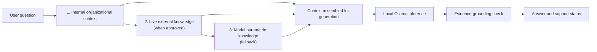
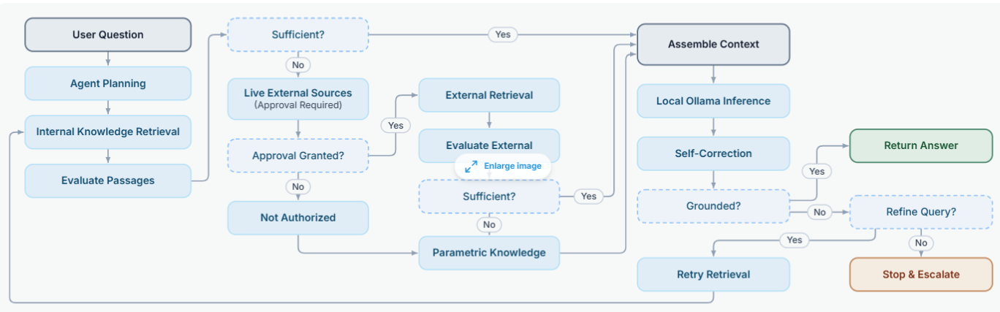

##  From Organizational Knowledge to Evidence-Grounded Answers

An end-to-end local demonstration of **agentic retrieval-augmented generation (RAG)**. The pipeline combines retrieval planning, prioritized knowledge sources, iterative query refinement, local inference, and an evidence-grounding check.

The central design question:  

> How can an AI agent retrieve and use organizational knowledge while remaining within defined evidence and access boundaries?

It is part of a broader direction: **building intelligence systems in which data and knowledge are not simply available to an AI model, but are selected, evaluated, and used under explicit operating rules**.

[**Governed Knowledge Architecture**](https://xiaoyanpan.com/#enterprise-ai-deployment)  ·  [**Why external search requires approval**](https://xiaoyanpan.com/Web_Search_Only_With_Approval.html)

## What this implementation demonstrates

- **Retrieval planning:** the agent can work through sub-queries rather than relying on one retrieval pass.
- **Prioritized knowledge sources:** internal organizational context is considered first, live external knowledge is subject to approval, and model parametric knowledge is treated as a fallback.
- **Local retrieval and inference:** document embeddings are stored in ChromaDB and generation is performed through a local Ollama endpoint.
- **Evidence checking:** retrieved passages are compared with the generated answer to identify weak textual support and possible need for query refinement.
- **Source traceability:** retrieved passages retain source-file and chunk metadata for inspection.

## Knowledge-source priority

The priority order distinguishes **organizational evidence**, **current external information**, and **general knowledge encoded in the model**. These sources are not interchangeable: parametric knowledge may support general reasoning, but it is not a verified source for current organizational facts.

## Architecture and agent governance 

The architecture diagram shows how the agent is instructed, how retrieval is organized, and how evidence is assessed.

The governing idea is that an agent may determine how to perform retrieval within its mandate; it does not independently redefine which sources it is authorized to use.

## End-to-end demonstration

`RAG_pipeline_demo.py` demonstrates the complete local workflow:

1. **Ingest** supported documents from the configured reports directory.
2. **Chunk** documents into overlapping text windows.
3. **Embed and store** chunks in a persistent ChromaDB collection.
4. **Retrieve** relevant passages for a user question.
5. **Generate and evaluate** an answer using a local Ollama model and a text-overlap support check.

Default inference model: `llama3.1:latest`

***The repository is a demonstration implementation. The real deployed pipeline separates indexing and retrieval stages and uses incremental ingestion.***

## Evidence evaluation: what the score means

`SimpleRAGAgent.self_correct()` compares lexical overlap between the generated answer and retrieved passages. It records support-related flags such as `supported` and `needs_rephrase`.

This is a **heuristic text-overlap check**, not a calibrated probability, a factuality guarantee, or proof that a statement is correct. A low overlap can indicate that the retrieved context does not adequately support the answer or that the query needs refinement.

## Retrieval strategy and model adaptation

| Approach | What changes | Appropriate use |
|---|---|---|
| Retrieval-augmented generation | Evidence supplied in the prompt | Bringing document-specific and changing information into a response |
| Fine-tuning | Model weights and learned behaviour | Adapting style, terminology, or task behaviour |

This repository implements the RAG approach. Fine-tuning is discussed as a complementary option, but model-weight adaptation is not implemented in this pipeline.

## Implementation details

| Area | Current implementation |
|---|---|
| Document formats | HTML, PDF, DOCX, TXT, Markdown |
| Embeddings | Sentence Transformers, default `all-MiniLM-L6-v2` |
| Vector store | Persistent ChromaDB |
| Local inference | Ollama, default `llama3.1:latest` |
| Retrieval | Similarity search with configurable top-k |
| Configuration | `.env` settings for paths and runtime parameters |

CSV files are not included in the current document-ingestion allowlist.

### Incremental-ingestion behaviour and limitation

Chunk IDs are derived from the filename and chunk index. Existing IDs are retained when the collection is reopened, and new IDs are added. The current `collection.add` approach does **not** replace an existing vector when a source file is edited but produces the same chunk IDs. A changed file may therefore require an explicit re-indexing or collection-refresh strategy to prevent stale chunks.

## Configuration

Create a local `.env` file beside the pipeline script. The file is excluded from version control.

| Variable | Purpose |
|---|---|
| `RAG_REPORTS_DIR` | Root directory containing source documents |
| `RAG_INDEX_DIR` | Persistent ChromaDB directory |
| `RAG_CHUNKS_DIR` | Chunk-output directory |
| `RAG_EMBEDDING_MODEL` | Embedding model; defaults to `all-MiniLM-L6-v2` |
| `RAG_COLLECTION_NAME` | ChromaDB collection name |
| `RAG_CHUNK_SIZE` / `RAG_CHUNK_OVERLAP` | Chunking configuration |
| `RAG_TOP_K` | Number of retrieved passages |
| `OLLAMA_MODEL` | Primary local inference model |
| `OLLAMA_FALLBACK_MODEL` | Fallback local model |
| `OLLAMA_URL` | Ollama endpoint; defaults to `http://localhost:11434` |

## Position within the broader work

This repository focuses on **how an AI system retrieves and evaluates knowledge**. The related [AI-DataSuite](https://github.com/panxiaoyan225-sudo/AI-DataSuite) explores the wider human–AI operating model: agent responsibilities, orchestration, supervision, and accountability.

**Technology enables retrieval.**   
**Organizational context establishes relevance.**   
**Evidence constrains the answer.**  
**Humans remain responsible for how knowledge is used.**

